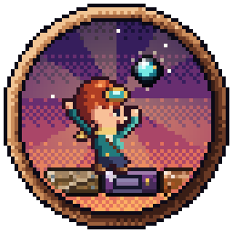
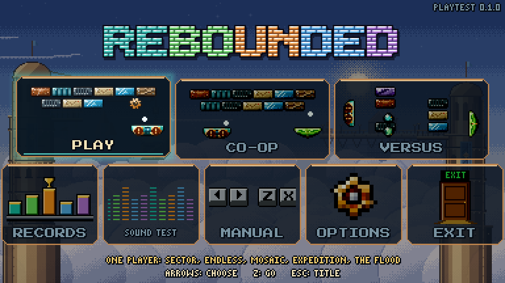
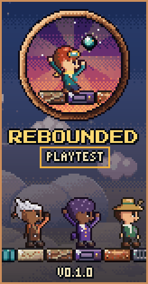
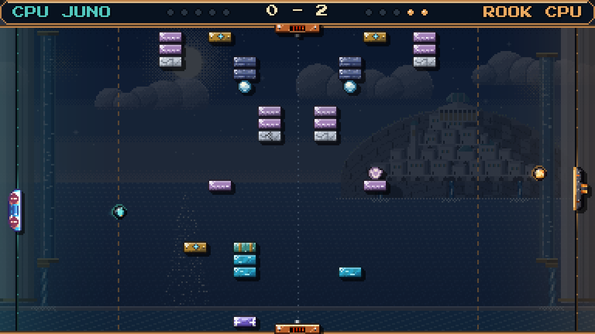

# REBOUNDED: Playtest

Thanks for testing! You've been sent this because Aven trusts you with an early look at **REBOUNDED**, the whole game
as it stands. It's a 16-bit-style brick breaker with real physics, machinery, two-screen boss stages and a crew of
heroes, each with an ability of their own.

## Getting it

1. **Download the installer:**
   [AVENGIS-Rebounded-Playtest-0.1.0-Setup.exe](https://github.com/Tracedicky/AVENGIS-Rebounded-Playtest/releases/latest/download/AVENGIS-Rebounded-Playtest-0.1.0-Setup.exe)
   (Windows, about 53 MB).
2. **Run it, and type in the password Aven gave you.** It won't install without it. Ask Aven if you don't have it,
   and please don't pass it on.
3. **If Windows says "Windows protected your PC",** click **More info**, then **Run anyway**. It's an indie game that
   isn't signed by a big publisher yet.

It installs just for you (no administrator needed), keeps its own saves, and never touches anything else. You start
from a fresh game, like any new player.

## What's in it

- **Five worlds**, each with its own bricks, machines and music, and a warden to beat at the end. There's a secret
  sixth world too.
- **Endless, Mosaic, the Expedition and The Flood**: different ways to play once you're comfortable.
- **CO-OP**: two players on one PC, including **TWIN COLOURS**, where each of you can only break your own colour.
- **VERSUS**: head to head against the CPU, a friend on the same PC, or **online** with a join code.

## Controls

| | Keyboard | Controller |
|---|---|---|
| Steer | Arrows / WASD / mouse | Stick / d-pad |
| Serve, and your hero's ability | Z / Space / click | A |
| Boost | Hold X | X |
| Pause | P / Esc | Start |
| Full screen | F11 | |

Controls can be changed in **OPTIONS**. The README that comes with the game has the full list.

## Playing online

**VERSUS**, set **AGAINST** to **ONLINE**, then **START**:
- **HOST A ROOM** gives you a five-letter code. Send it to your rival.
- **JOIN A ROOM** lets you type in their code.

You'll go straight into the match. It needs an internet connection; if anything goes wrong, the screen tells you what.

## Found something?

Everything helps: what felt good, what felt off, what confused you, anything that looked wrong. Tell Aven.

If the game ever crashes, it saves a report of what happened in `%LOCALAPPDATA%\AVENGIS\Rebounded Playtest\logs`.
Closing the crash screen opens that folder. Please send Aven the report, and a line about what you were doing. The
title shows the version in its top corner (this is **PLAYTEST 0.1.0**).

## Uninstalling

Windows **Settings > Apps**, or **Uninstall AVENGIS Rebounded Playtest** in the Start menu. It asks whether to remove
your saves too.

---

Made by **AVENGIS**. Music and sound are original, written for the Mega Drive's chips.

Installer SHA-256: `1B9FE0204FF78A9B28FC6F55A4CA17928F12B059905F2D87F9D80A0484056931`
